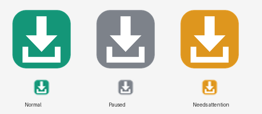

# Steam Auto Queue

A small Windows tray app that moves Steam game updates out of **Scheduled** and into **Up Next**, so they download right away.

> Independent project. Not made by, affiliated with, or endorsed by Valve or Steam.

## Why

Steam spreads out updates by scheduling many of them for an off-peak time, often overnight. If your PC is off or asleep then, the updates sit in Scheduled until you click each one by hand. Steam Auto Queue does that clicking for you.

## Install

1. Download the latest `SteamAutoQueue-x.y.z.zip` from [Releases](https://github.com/SquilliamSki/SteamAutoQueue/releases/latest).
2. Unzip it and double-click **Install.cmd**.
3. If Steam is open, say **Y** when it offers to restart Steam once.

No admin rights needed. If Windows shows "Windows protected your PC", click **More info → Run anyway** (it appears for any script downloaded from the internet).

The icon may land in the hidden **^** area by the clock. Drag it onto the taskbar to keep it visible.

## Using it

There's nothing to do day to day. By default, a minute after Steam starts it queues everything in Scheduled, then checks again every 30 minutes while Steam is open.



| Icon | Meaning |
|---|---|
| Green | Working normally |
| Gray | Paused |
| Orange | Needs attention (hover to see why) |

- **Double-click** queues everything right now.
- **Right-click** for Queue updates now, Pause/Resume, Open Steam downloads, Settings, View log, Check for updates, About, and Exit.

### Settings

Right-click → **Settings** opens a plain text file where every option is explained. Changes apply within seconds. For example, to run once a day at 7 PM instead of at Steam startup:

```ini
RunWhenSteamStarts = false
DailyTime = 19:00
```

Other options: start Steam for the daily run, re-check interval, skip specific games, include Unscheduled updates, notifications, and a test mode that only logs what it would do.

### Uninstall

Start Menu → **Uninstall Steam Auto Queue**. This removes everything listed under [What it changes](#what-it-changes).

## How it works

Steam's interface runs on Chromium, and Steam has a developer switch (`-cef-enable-debugging`) that lets programs on the same PC talk to it. With the switch on, the tray app reads Steam's download list and calls Steam's own "queue this update" function for each Scheduled game, which is the same thing that happens when you click a game's download button. It doesn't download anything itself or modify Steam's files.

### What it changes

- Adds an empty marker file `.cef-enable-remote-debugging` to the Steam folder, and adds the switch to Steam's "start with Windows" entry.
- Adds a Task Scheduler entry, **Steam Auto Queue**, that starts the tray app at login.
- Copies itself to `%LOCALAPPDATA%\SteamAutoQueue` and adds Start Menu shortcuts.

### Things to know

- **Security trade-off:** the debug switch only listens on `127.0.0.1` (this PC, not your network). While it's on, though, any program already running on your PC could control Steam through it. Steam UI mods like Millennium and Decky make the same trade-off. If that isn't acceptable for you, don't install this.
- **It can break:** it relies on Steam's internal, undocumented functions. If a Steam update changes them, the icon turns orange and says so, and Steam goes back to its normal scheduling until there's a fix.
- **Auto-fix restart:** if Steam starts without the switch (for example after Steam updates itself), the app restarts Steam once, right after it opens and never while a game is running. Turn this off with `AutoFixSteam = false`.
- **Resources:** one PowerShell process, roughly 60–100 MB of memory and effectively no CPU.
- **Privacy:** the only network request the app makes is a weekly check of this repository's latest release on GitHub (`CheckForUpdates = false` turns it off). Logs and state stay on your PC.

## Development

```
src/        Everything that ships in the release zip
  SteamAutoQueue.ps1   The whole app (install, tray, uninstall)
  Install.cmd / Uninstall.cmd
  settings.ini         Default settings, documented inline
  README.txt           User guide included in the zip
tests/      Test suite + a fake Steam server (Node.js, no dependencies)
tools/      Build-Release.ps1 makes dist/SteamAutoQueue-<version>.zip
docs/       Images for this page
.github/    CI (tests on Windows) and the release workflow
```

Run the tests (needs [Node.js](https://nodejs.org) 18+):

```powershell
powershell -ExecutionPolicy Bypass -File tests\Run-Tests.ps1
```

The tests run against a fake Steam, so they check the queueing and tray logic but not real Steam. After changing anything that talks to Steam, also try it on a real install.

### Releasing

1. Bump `$AppVersion` near the top of `src/SteamAutoQueue.ps1` and add an entry to `CHANGELOG.md`.
2. Commit, then tag and push: `git tag v1.2.0` and `git push origin main --tags`.
3. GitHub Actions runs the tests, builds the zip, and publishes the release. Installed copies will notice it within a week.

Keep shipped files ASCII-only; Windows PowerShell 5.1 misreads non-ASCII text in scripts saved without a BOM.

## License

[MIT](LICENSE)
